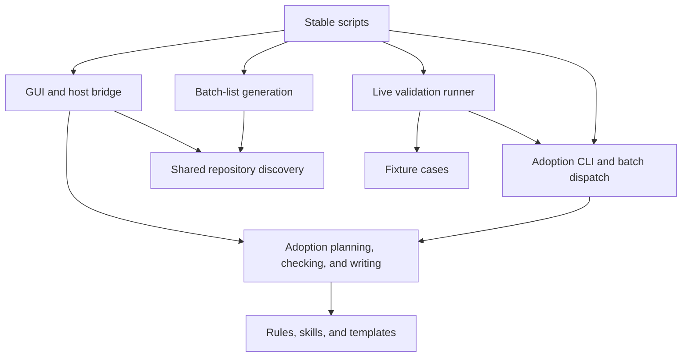

# Repository Architecture

This repository distributes rules, templates, and shared skills. Its Python
helpers run from a checkout without installing a Python package. Keep the
public command paths stable and place implementation behind them.

## File responsibilities

```text
agent-rules/
├── AGENTS.md, CLAUDE.md, GEMINI.md   Agent entrypoints for this repository
├── rules/                         Shared working policy
├── skills/                        Deployable skill instructions and metadata
├── templates/                     Generated entrypoints and reusable task formats
├── docs/                          Usage guides and validation evidence
├── scripts/
│   ├── adopt.py                   Stable CLI and compatibility re-exports
│   ├── generate_batch_list.py     Batch-list command and compatibility re-exports
│   ├── gui.py                     GUI command
│   ├── ai_bridge.py               Host AI bridge command
│   ├── forward_test.py            Live validation command
│   ├── docker/                    Linux/WSL lifecycle scripts
│   │   ├── start.sh               Start Docker GUI and host bridge
│   │   ├── stop.sh                Stop Docker GUI
│   │   └── check.sh               Check host AI CLI readiness
│   └── agent_rules/
│       ├── cli.py, batch.py        Adoption dispatch
│       ├── batch_list.py           Candidate list arguments and output
│       ├── discovery.py            Repository traversal shared by CLI and GUI
│       ├── source.py, metadata.py  Source and adoption identity
│       ├── render.py, planning.py  Content generation and merge plans
│       ├── applying.py, gitignore.py
│       │                           Writes, backups, and visibility
│       ├── checking.py, removal.py Ownership checks and removal
│       ├── constants.py, models.py, gitio.py
│       │                           Common policy, data, and Git operations
│       ├── gui/
│       │   ├── launch.py           Listener and browser startup
│       │   ├── web.py              HTTP routes and request validation
│       │   ├── service.py          Workspace, previews, and deployment operations
│       │   ├── ai.py               Local AI CLI and memory access
│       │   ├── bridge.py           Authenticated job exchange and scoped execution
│       │   ├── host_bridge.py      Host polling command implementation
│       │   └── assets/             HTML, CSS, and JavaScript
│       └── forward_test/
│           ├── cases.py            Live test prompts and fixture definitions
│           └── runner.py           Agent execution, provenance, and evidence output
├── tests/                         Deterministic Python and frontend checks
├── Dockerfile, compose.yaml        GUI container build and runtime configuration
└── requirements-*.txt, ruff.toml  Dependency and lint configuration
```

## Dependency boundaries



- Implementation modules import other implementation modules. They do not
  import the public script wrappers. Live validation deliberately invokes
  `scripts/adopt.py` in a subprocess to exercise the supported deployment command.
- GUI dependencies stay inside `gui/`. Its package initializer does not load
  FastAPI, Pydantic, or Uvicorn; adoption and discovery remain standard-library
  tools. Use `requirements-gui.txt` only when GUI or bridge execution is needed.
- HTTP routes delegate deployment to `service.py`, which uses the same planner,
  checker, and writer as the CLI. Keep preview validity, path restrictions, and
  write ownership checks at their existing boundaries.
- Web assets live beside their HTTP adapter. Docker copies the entire
  `scripts/` tree, so the same asset layout works locally and in the image.
- Live validation stays separate from deterministic tests. Its command can
  consume authenticated agent usage; unit tests use fake CLIs instead.

## Structure review

The previous layout mixed GUI modules and web assets with adoption internals,
and kept batch-list and live validation implementations in executable scripts.
The GUI also imported discovery from `generate_batch_list.py`, while that script
imported the `adopt.py` compatibility surface. Shared `discovery.py` removes that
dependency on command wrappers. GUI grouping and the live validation subpackage
make ownership visible without introducing a package installation step.

The existing adoption modules already separate planning, writing, and checking.
They remain at the package root: moving them into another layer would add import
churn without resolving the observed dependency problem. `adopt.py` keeps its
explicit re-exports for existing import consumers. Internal GUI imports now use
`agent_rules.gui.*`; validation internals use `agent_rules.forward_test.runner`.

Root agent entrypoints, Docker build files, Compose configuration, and dependency
files remain at their conventional locations. `scripts/docker/` groups the
operational shell commands with the other executable tools. The earlier
`docker/*.sh` paths have moved to `scripts/docker/*.sh`; update local shortcuts
accordingly. `rules/`, `skills/`, and `templates/` remain separate
because deployment treats them as different content sources.

The [documentation index](README.md) routes users to a separate usage guide for
each tool. Architecture and historical validation evidence stay in their own
documents.

Some files remain large, especially `planning.py`, `gui/service.py`, and
`tests/test_adopt.py`. Size alone does not require another abstraction. Revisit
their boundaries when new responsibilities emerge; preserve the existing merge,
ownership, and preview behavior when doing so.

## Validation

Install `requirements-dev.txt`, then run:

```bash
python -m pytest tests/ -q
ruff check scripts/ tests/
node --test tests/gui_frontend.test.cjs
bash -n scripts/docker/start.sh scripts/docker/stop.sh scripts/docker/check.sh
git diff --check
```

The Python suite covers deployment, discovery, GUI workflows, and fake-agent
evidence collection. Entry-point tests run each public Python command with
`--help` from outside the checkout and check that non-GUI commands can load
without GUI dependencies. Container startup and live authenticated agent runs
are separate integration checks.
